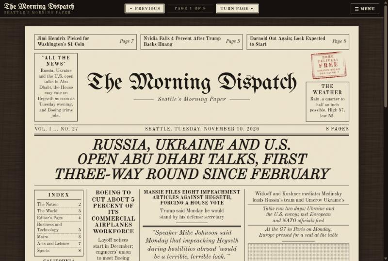
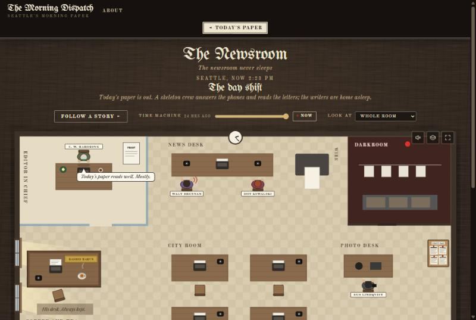
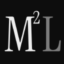

# Hi, I am Mahatab 👋

**I build software at [M² Labs](https://m2labs.io): desktop, mobile and web apps, and the AI agent systems behind them. Based in the Greater Seattle area.**

> Microsoft gave me 17+ years of scars and instincts. AI gave me wings. Let us ship something.

## 17+ years at Microsoft

Almost a decade of it on **Azure App Service**, the platform behind more than 2 million apps and sites and 60 billion requests a day.

- **Senior TPM** — led Quality, Reliability, and Security programs across **Developer Division (CoreAI)**
- **Senior Embedded Escalation Engineer, Azure App Service** — worked directly with the engineering team to bring down the cost of supporting the service, and built diagnostic tools that were adopted globally across App Service and later shipped in the Azure Portal. Also the final escalation point for the service's most complex incidents
- **Global escalation lead for Windows Media SDK** — the person who got the 3 AM call. Wrote debugging tools and prototype fixes that went into Windows builds, and turned customer incidents into hotfixes shipped through Windows updates

## What I am building

###  [Synode](https://github.com/mahatab/synode-council-of-ai-agents) — a council of AI models, one verdict

Several AI models debate your question, and a master model delivers the final verdict. Follow up with any model by @mention. Works with 8 cloud providers and local models.

 macOS &nbsp;·&nbsp;  Windows

  
  

###  [The Morning Dispatch](https://themorningdispatch.net) — a daily paper with no humans in the newsroom

A 1970s-style newspaper written every morning by AI scouts, AI writers and an AI editor in chief. Every mistake becomes a new rule in the editor's desk book, so the paper gets better each week. [Watch the newsroom](https://themorningdispatch.net/newsroom.html).

  
  

### Windows power tools, rebuilt for the Mac

After two decades on Windows, I missed a few things on macOS. So I built them.

-  **[tcpview-macos](https://github.com/mahatab/tcpview-macos)** — Sysinternals TCPView for the Mac: live TCP and UDP connections, in native SwiftUI

-  **[memorylens](https://github.com/mahatab/memorylens)** — memory visualization for macOS

  
  

### Windows muscle memory on macOS

Small helpers for anyone who moved from Windows to the Mac and kept the habits.

-  **[macrun](https://github.com/mahatab/macrun)** — the Win+R Run dialog as a menu bar app, with 105+ command aliases
-  **[wincmdbridge](https://github.com/mahatab/wincmdbridge)** — a Zsh plugin that turns Windows CMD commands into Unix ones on Tab

### Also

-  **Magic Mend** — an AI app that fixes your writing in any app. Closed source. &nbsp; Windows &nbsp;·&nbsp;  macOS
-  **BeenHere** — an iOS app. Closed source. &nbsp; iOS
-  **[M² Labs](https://m2labs.io)** — my technology studio. Software development meets AI audio production.

## Recognition

- **Microsoft Award for Customer and Partner Experience** — three-time recipient, for enterprise support and customer advocacy
- **Frost and Sullivan Excellence in Technology Award** — for the SIP engine I developed for the BroadWorks Communicator softphone

## Random facts

- Started my career writing Telnet/SSH clients for Windows, PocketPC and Palm OS
- My freeware **RemoveCIH Antivirus** was named one of the best utilities of the year by PC Utility Magazine UK, in 2002
- Have debugged Windows user and kernel memory dumps at 2 AM more times than I can count
- Coffee-powered

## Connect

